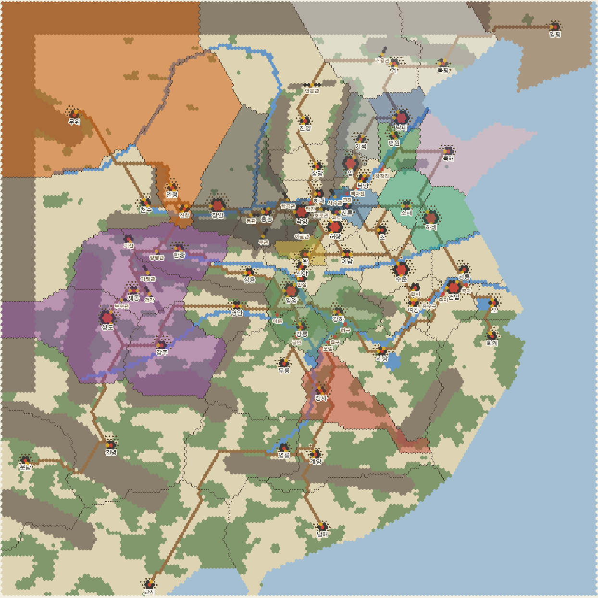

# sam11 — 삼국지 신작 프로젝트

삼국지 5~11의 호평 시스템을 조합한 군주제 전략 시뮬레이션. Unity, 풀 3D, 수묵화풍.

## 폴더

| 폴더 | 내용 |
|---|---|
| `docs/design/` | 설계서 (00 개요 ~ 09 데이터 형식) |
| `data/` | 게임 데이터 JSON (무장·거점·진형·전법·특기·보물·시설·기교·규칙, 시나리오) |
| `src/Sam11.Core/` | 게임 코어 (순수 C#, .NET Standard 2.1 — Unity에서 그대로 사용) |
| `tests/Sam11.Core.Tests/` | 코어 단위 테스트 |
| `tools/validate_data.py` | 데이터 형식·참조 검증 |
| `tools/Sam11.Sim/` | 시연 콘솔 (호로관 전투, 경제 점검, 사수관 공략) |
| `tools/mapgen/` | 전국 맵 생성기와 미리보기 렌더러 |
| `data/map/` | 지리 원본(`geography.json`)과 생성된 맵(`world.json`) |

## 실행

데이터 검증 (Python 3 + `jsonschema`):

```bash
python3 tools/validate_data.py
```

코어 테스트 (.NET 8 SDK):

```bash
dotnet test tests/Sam11.Core.Tests
```

전투 시연 (시드, 날씨: clear / rain / snow / fog / gale):

```bash
dotnet run --project tools/Sam11.Sim -- 190 clear
```

경제 점검 (명령 없이 N개월 진행):

```bash
dotnet run --project tools/Sam11.Sim -- economy 12
```

전국 맵 공성 시연 (조조군의 사수관 공략):

```bash
dotnet run --project tools/Sam11.Sim -- siege
```

맵 다시 생성 (`data/map/geography.json`을 고친 뒤):

```bash
python3 tools/mapgen/generate_world.py
```

```bash
python3 tools/mapgen/render_world.py 190
```


